<div align="center">

# oma-cast

**A Raycast-esque launcher for [Omarchy](https://omarchy.org), with emoji, clipboard history, window layouts, snippets, quicklinks, a calculator and agent hand-offs built in.**

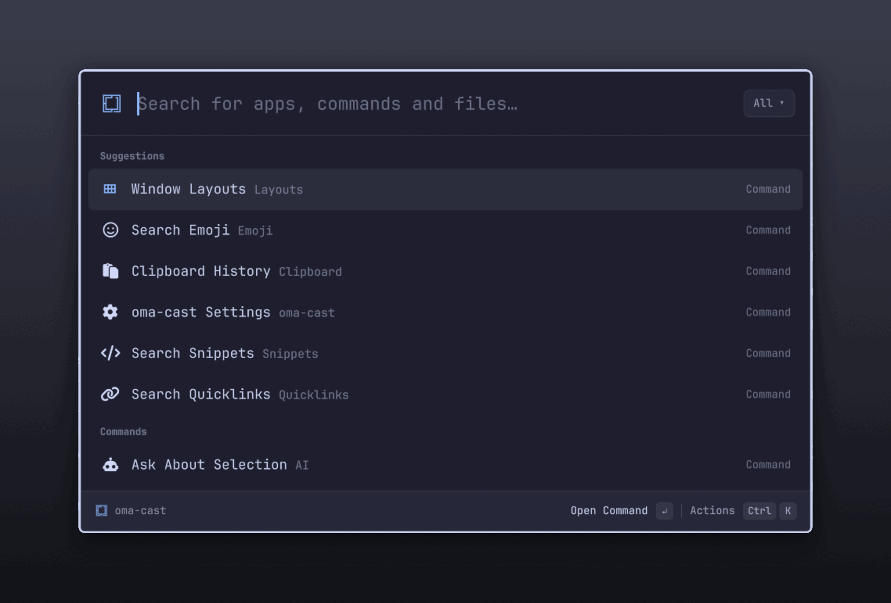

</div>

---

This is my fork of [typecraft-dev/oma-cast](https://github.com/typecraft-dev/oma-cast). It keeps upstream's search, ranking and Omarchy integration and adds the features I used to get from [omalaunch](https://github.com/cpreston321/omalaunch), plus a reorganised Settings window.

## What's in it

* **One search for everything.** Apps, all ~400 Omarchy menu actions (with breadcrumbs and live ✓ state), keybindings, files, snippets, quicklinks, saved layouts, calculations and web-search fallbacks.
* **Learns your habits.** Raycast-style root-search ranking plus frecency and learned search terms: type `ff`, pick Firefox, and `ff` keeps meaning Firefox.
* **Emoji, clipboard history and window layouts** as root commands, each with its own alias and hotkey.
* **Snippets and quicklinks** with Raycast's placeholders, imports and exports.
* **A calculator** for units, ~170 currencies, time zones, dates, bases and percentages.
* **Your coding agent one keystroke away.** `?` asks Claude Code, Codex or whichever agents you have installed; ask about the selection, a clipboard entry or a file.
* **A Settings window** with an Extensions page per feature, search across every setting, and advanced rows tucked away.
* **Native to Omarchy.** A plugin for `omarchy-shell`: no Electron, no Node, no daemons. It opens in about 40 ms and follows `omarchy theme set` live.

## Screenshots

<table>
  <tr>
    <td width="50%">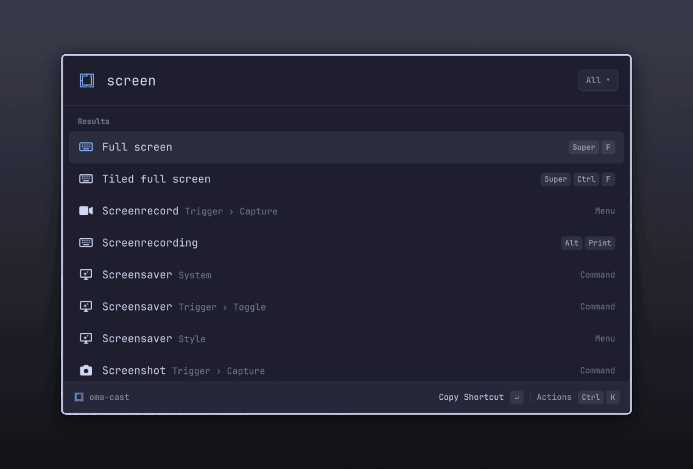</td>
    <td width="50%">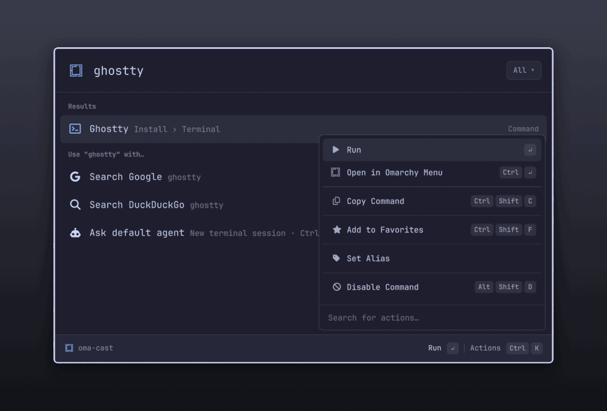</td>
  </tr>
  <tr>
    <td align="center"><b>Every Omarchy action and keybinding</b></td>
    <td align="center"><b>Ctrl+K: actions for any result</b></td>
  </tr>
  <tr>
    <td>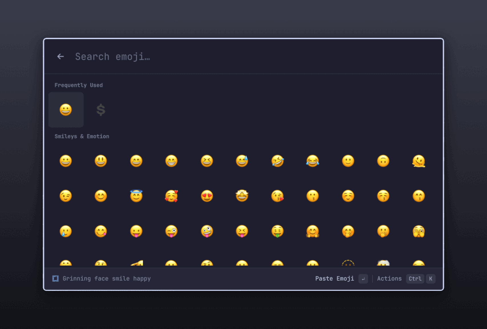</td>
    <td>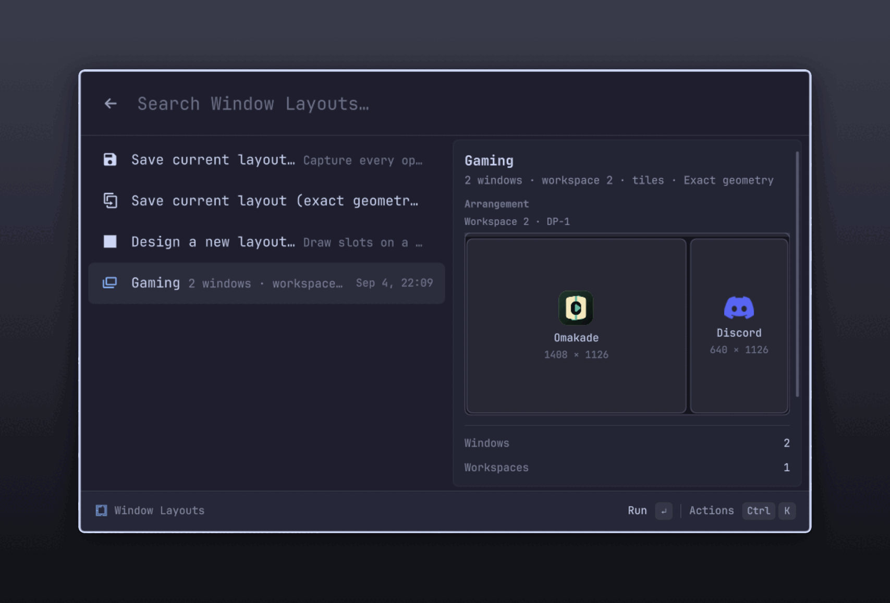</td>
  </tr>
  <tr>
    <td align="center"><b>Search Emoji</b></td>
    <td align="center"><b>Window Layouts, with a preview</b></td>
  </tr>
  <tr>
    <td>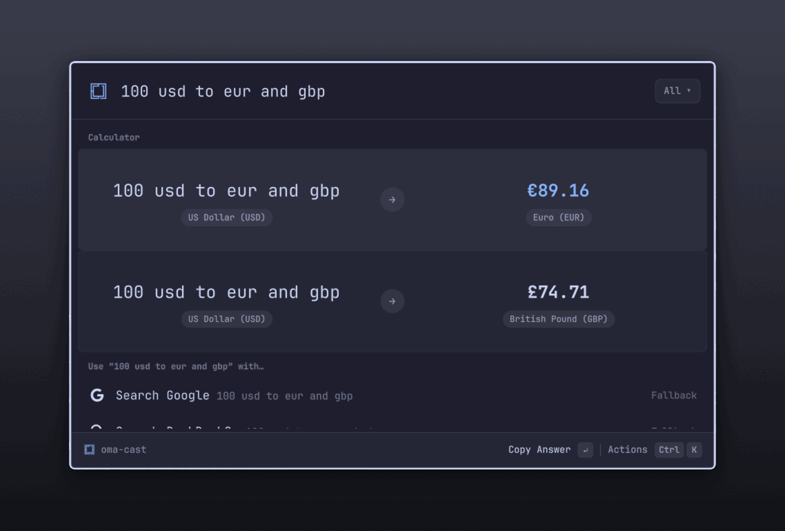</td>
    <td>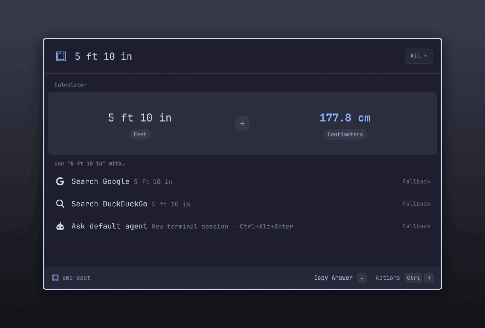</td>
  </tr>
  <tr>
    <td align="center"><b>Currencies, several at once</b></td>
    <td align="center"><b>Units convert on their own</b></td>
  </tr>
  <tr>
    <td>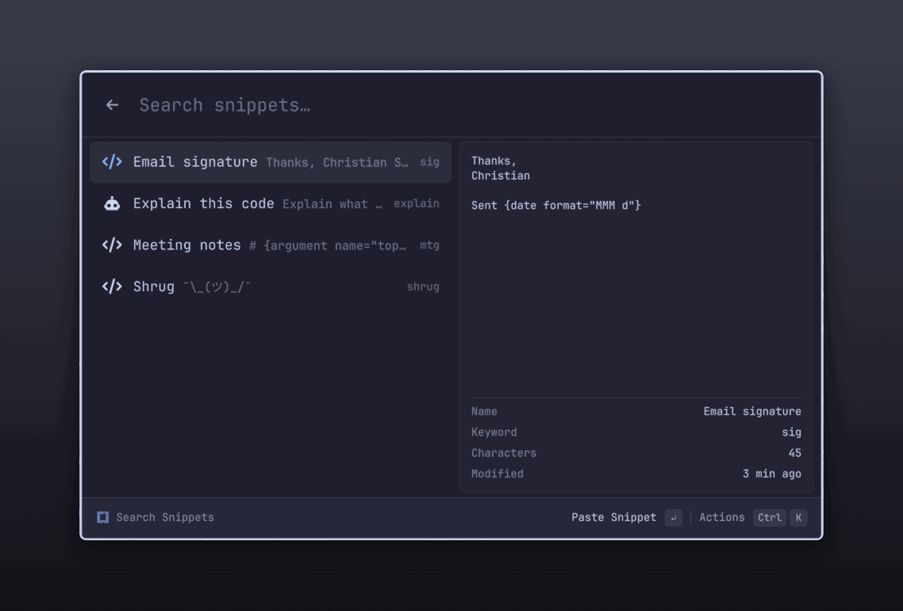</td>
    <td>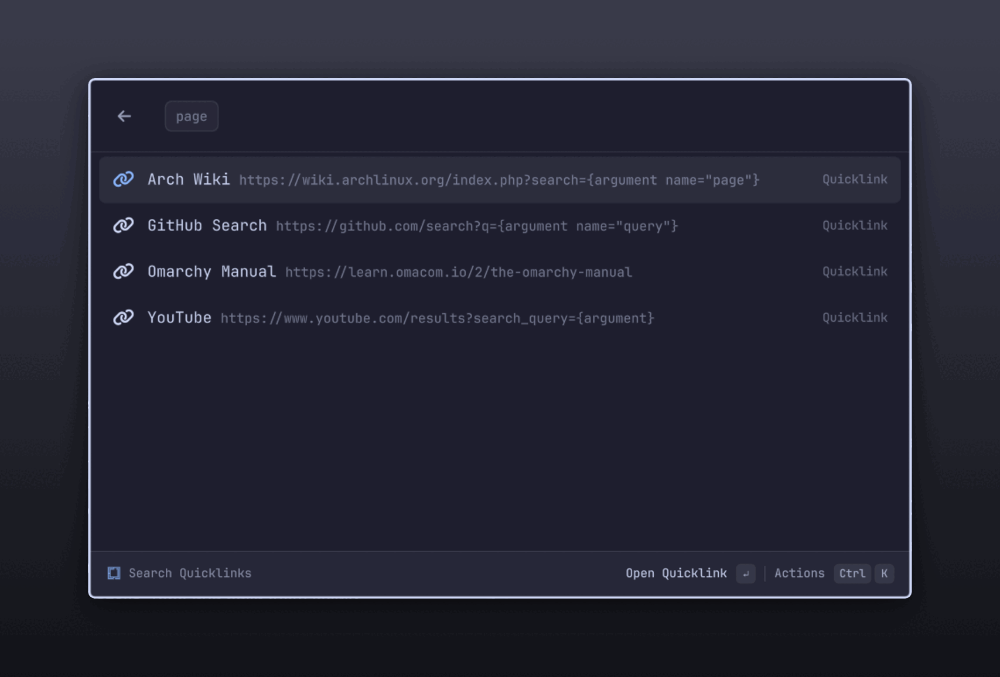</td>
  </tr>
  <tr>
    <td align="center"><b>Snippets and AI Commands</b></td>
    <td align="center"><b>Quicklinks with arguments</b></td>
  </tr>
  <tr>
    <td>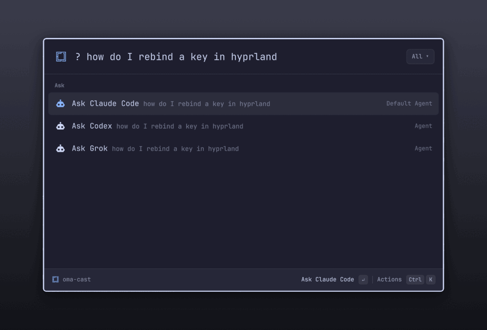</td>
    <td>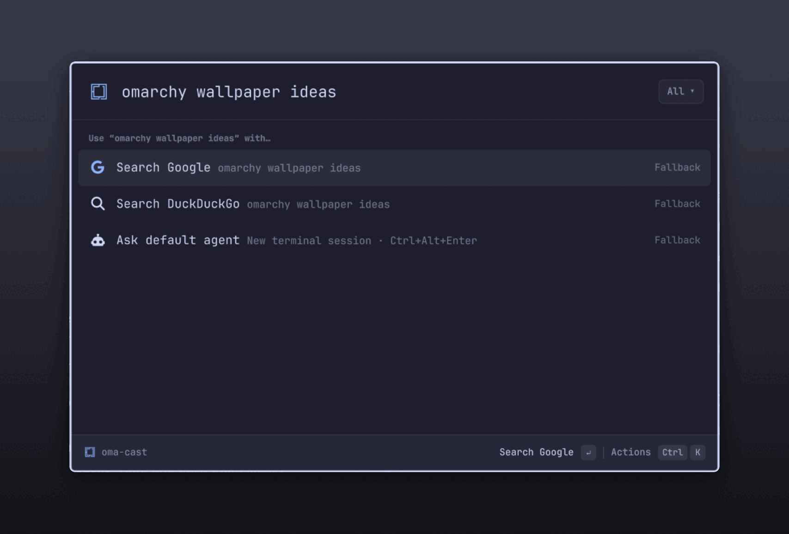</td>
  </tr>
  <tr>
    <td align="center"><b><code>?</code> asks any installed agent</b></td>
    <td align="center"><b>No match? Search the web or ask your agent</b></td>
  </tr>
</table>

<p align="center">
  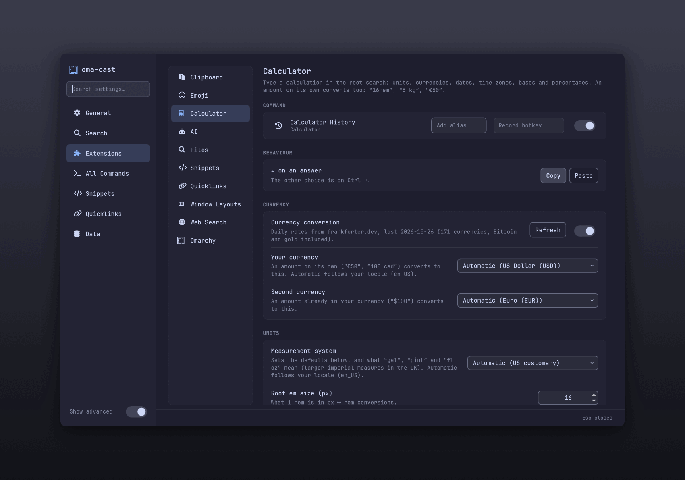
  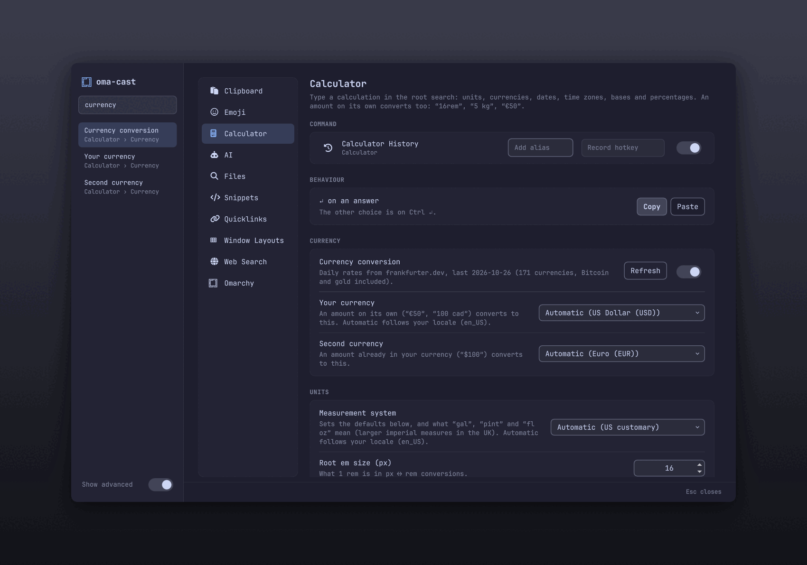
</p>
<p align="center"><b>Settings: one page per extension, and search across every setting</b></p>

There's no theme config: oma-cast binds to Omarchy's own colours, so it changes the moment you switch themes.

## Install

Requires Omarchy 4 (Hyprland 0.56+, `omarchy-shell`) and `socat`, which Omarchy already ships.

```sh
git clone https://github.com/cpreston321/oma-cast.git
cd oma-cast
bin/oma-cast install          # link the plugin into omarchy-shell and the CLI into ~/.local/bin
oma-cast setup hyprland       # bind Alt+Space
oma-cast doctor               # check everything is wired up
```

Press **Alt+Space**. Super+Space stays the Omarchy menu. You can change the launcher binding in `~/.config/hypr/oma-cast.lua`, or in Settings → General.

To remove it: `oma-cast uninstall`.

## Ask your agent

Nothing is answered inside oma-cast: each of these opens a new terminal session
with your question in the agent, through Omarchy's own launcher
(`omarchy-agent`), in Omarchy's default terminal.

* **`?` then a space and your question** lists one **Ask** row per installed
  agent, your default first. Settings → Extensions → AI changes the prefix or turns it off.
* **Ask default agent** sits under the web-search fallbacks for any query;
  **Ctrl+Alt+Enter** sends the root-search text straight to it. **Ctrl+K** on it
  asks one of your other agents instead, for that question only.
* **Ask Agent** takes the question in a pill, so it can have its own hotkey or
  alias. **Ask About Selection** asks about the text you had selected in the app
  you came from.
* **Ctrl+K → Ask Agent About This** on a clipboard entry (its text, or an image's
  file) or a file or folder (the session starts in its folder).
* **AI Commands**: a snippet with *Send to your agent instead of pasting* turned
  on. ↵ fills its placeholders, including `{selection}`, and sends the text to
  your agent.

An agent counts as installed when Omarchy has installed it (its
install-on-first-use wrapper alone doesn't count). Settings → Extensions → AI
picks the default agent (saved where `omarchy-default-agent` saves it, without
starting a session), shows each agent's plan usage from Omarchy's usage
records, and sets the folder sessions start in.

The setup is checked first: a missing agent or terminal leaves the launcher
open with your question and an error. Needs an Omarchy with
`omarchy-agent-prompt` and `omarchy-agent --prompt`. Sign-in, approvals and the
terminal stay with Omarchy and the agent CLI; oma-cast doesn't keep the
question in search history, read credentials or call any model API.

## Emoji, clipboard history and window layouts

Carried over from [omalaunch](https://github.com/cpreston321/omalaunch). Each one is a
root command, so you can alias or favorite it like anything else.

* **Search Emoji.** A grid of Omarchy's emoji set plus currency signs, grouped
  by category with a *Frequently Used* row on top. Search matches word
  prefixes (`smi fac` finds smiling faces). Arrow keys move around the grid,
  `Ctrl+↑/↓` jumps between groups, `↵` pastes and `Ctrl+↵` copies.
* **Clipboard History.** Reads Omarchy's own clipboard history. Shows text, files
  and screenshots with a detail pane beside the list. `↵` pastes, `Ctrl+↵` copies
  and `Ctrl+Shift+↵` opens the entry. oma-cast never writes the history.
* **Window Layouts.** Save the current window arrangement and restore it later,
  with a preview of each saved layout. Saved layouts also appear in root search
  while you type (`gaming` → *Gaming*). `↵` applies, `Ctrl+↵` applies and launches
  missing apps, and the rest (overwrite, rename, delete, edit in the
  [layout designer](https://github.com/cpreston321/omalaunch-layout-designer))
  are in `Ctrl+K`. Layouts live in `~/.local/state/omarchy/omalaunch-layouts`, so
  ones saved with omalaunch carry over. Needs `python3`.
* **omalaunch user extensions.** Action entries in
  `~/.config/omarchy/omalaunch/extensions.d` (static `.json` files or a
  `provider` executable) show up in root search while you type, e.g. a camera
  from a UniFi provider. Other omalaunch modes aren't supported.

## Snippets

**Search Snippets** lists them with a preview; a snippet also turns up in
root search by its name or keyword. `↵` pastes, `Ctrl+↵` copies, `Ctrl+E`
edits and `Ctrl+D` deletes. **Create Snippet** (or Settings → Snippets) has
a multi-line editor that checks the text as you type.

Placeholders follow Raycast's: `{cursor}` (the caret lands there after
pasting), `{clipboard}` / `{clipboard offset=1}` (from clipboard history),
`{argument name="who" default="team"}` (up to three, shown as pills),
`{date format="yyyy-MM-dd" offset="+1d"}`, `{time}`, `{datetime}`, `{day}`,
`{uuid}`, `{calculator expression="2+2"}`, `{snippet name="Signature"}`, and
the modifiers `| uppercase`, `| lowercase`, `| trim`, `| percent-encode`,
`| json-stringify`. Any other `{word}` stays as written, so code pastes
untouched. Snippets expand from the launcher only: typing a keyword in
another app does nothing (that needs input-device access).

Import and export use Raycast's JSON format, `[{name, text, keyword?}]`.

## Calculator

Type a calculation in root search. An amount and a unit on their own convert
to the obvious counterpart: `16rem` → 256 px, `5 kg` → 11.02 lb, `100 f` →
37.78 °C, `5'10"` → 177.8 cm. Money works the same way: `€50` converts to your currency
and `$100` to your second one (Settings → Extensions → Calculator; both follow your locale
by default). About 170 currencies, Bitcoin and gold included: `100 usd to aed`,
`50 dirhams to usd`, `CA$100`, `1 btc`, `100 dollars in pounds`,
`1 oz gold`, `10 g of silver in eur`. Ask for several at once with `and` or commas:
`100 usd to eur and gbp`, `5 ft to cm, m`, `3pm london to nyc and tokyo`. Words like
"pesos", "dinars" or "dollars" mean your currency when it's one of them. The defaults follow your measurement system (US, UK or Metric, from your
locale): in the US `180 cm` → 5 ft 10.87 in and `70 kg` → 154.32 lb; in the UK
`70 kg` → 11.02 st and a pint is 568 mL. Pick what each unit converts to, or
switch one off, in Settings → Extensions → Calculator. Name a target with `to`/`in`: `180 cm in feet
and inches`, `1 gb to mb`, `16 oz to ml`, `1in to px`, `0 c in k`. Currencies,
dates, time zones, bases and percentages work too. ↵ copies the answer.

## Settings

**oma-cast Settings** in root search, `Ctrl+,` in the launcher, or
`oma-cast settings [tab]`. `Ctrl+1`…`7` switch tabs, `Ctrl+F` searches every
setting, `Ctrl+S` saves, `Esc` clears the search, then closes.

Each page groups its settings into cards. **Search settings…** at the top of the
sidebar finds any setting by name, description or what it's about ("currency",
"vim", "log"); ↵ or a click opens its page, scrolls to it and highlights it.
Rarely needed rows (focus behaviour, rem size, work-day hours, log level) stay
hidden until **Show advanced** is on; searching for one turns it on.

| Tab | What's in it |
|---|---|
| General | Window (mode, compact favorites, text size, size, monitor), Keyboard (launcher hotkey, Esc, navigation keys, return to root) |
| Search | Ranking (sensitivity, Suggestions), rows that join root search (keybindings, files), and the "Use <query> with…" fallbacks |
| Extensions | One page per feature, as in Raycast: its commands' aliases, hotkeys and on/off switches, then its settings. Clipboard, Emoji, Calculator, AI, Files, Snippets, Quicklinks, Window Layouts, Web Search, Omarchy |
| All Commands | Every command's alias, hotkey and on/off switch in one filterable list |
| Snippets, Quicklinks | Editors, import and export; a snippet can be an AI Command |
| Data | Clear search history, reset rankings, clear emoji recents, back up and restore everything, log level |

`oma-cast settings calculator` (or `ai`, `clipboard`, `emoji`, `files`…) opens
that extension.

**Hotkeys** go in `~/.config/hypr/oma-cast.lua`, which Settings rewrites and
`hyprland.lua` loads (`oma-cast setup hyprland` adds the `require`). Click a
hotkey field and press the keys: while it records, Hyprland is put in an
empty submap so combos it already binds reach the field (10 s at most;
Super+Ctrl+Alt+Shift+F12 also leaves it). A hotkey that Omarchy already uses
replaces Omarchy's binding, and Settings says which one. Any command can have
one: a hotkey on a snippet pastes it into the focused app.

### Bar button and Super+Space

`oma-cast install-button` puts an Omarchy logo at the left of the bar that
opens oma-cast. It is a separate plugin (`bar-button/`) copied in as plain files,
because Qt won't load a bar widget through the symlinked plugin folder. To open
oma-cast with Super+Space instead of the Omarchy menu, add this to
`~/.config/hypr/bindings.lua`:

```lua
hl.unbind("SUPER + SPACE")
o.bind("SUPER + SPACE", "oma-cast", hl.dsp.global("oma-cast:toggle"))
```

Keep `omarchy.menu` enabled: the theme, background and apps keys and Omarchy's
scripts still open its routes.

## Keyboard

| Key | Does |
|---|---|
| `↵` / `Ctrl+↵` / `Ctrl+Shift+↵` | Run the first, second or third action |
| `Shift+↵` | Open a new window of an app (`↵` switches to the one already open) |
| `Ctrl+K` | Open the action panel |
| `Super+V` / `Ctrl+V` / `Ctrl+Shift+V` / `Shift+Insert` | Paste text into the query (also accepts clipboard-history selections) |
| `Ctrl+Alt+↵` | Ask the default agent using the current root-search text |
| `Ctrl+1`…`9` | Pick a result |
| `←` / `→`, `Home` / `End` | Move the query cursor (`Shift` to select text) |
| `↑` on an empty search | Search history |
| `Ctrl+↑` / `Ctrl+↓` | Jump between sections |
| `Ctrl+N` / `Ctrl+P` | Next / previous |
| `Ctrl+Shift+F` | Add to favorites (`Ctrl+Alt+↑↓` to reorder) |
| `Ctrl+Shift+C` | Copy |
| `Tab` / `Shift+Tab` | Move into and between a quicklink's arguments |
| `Ctrl+E` / `Ctrl+D` | Edit / delete a quicklink |
| `Alt+Shift+D` | Disable a command |
| `Esc` / `Shift+Esc` | Back / back to root |
| `Ctrl +` / `Ctrl −` / `Ctrl 0` | Zoom |

## Keybindings search

Press **Alt+Space**, search for **Search Keybindings**, and press Enter.
Search by action (for example `file manager`) or chord (`Super+Shift+F`).
Shortcuts appear as keycaps; Enter or Ctrl+Shift+C copies the selected chord.
Escape returns through the launcher navigation. Bindings also appear in root
search, and Learn → Keybindings opens this native view.

The list refreshes from `omarchy menu keybindings --print` whenever the launcher
opens, including personal bindings and the active keyboard layout. Selecting a
shortcut copies it; it does not execute its desktop action. Direct access:
`oma-cast run builtin:keybindings`.

## CLI

```sh
oma-cast toggle | show | hide
oma-cast run <commandId>         # e.g. app:com.mitchellh.ghostty, omarchy:style.theme
oma-cast call <method> [json]    # call any backend method
oma-cast doctor
```

## Development

```sh
node --test tests/*.test.js # unit tests, no npm install needed
tests/smoke.sh            # live checks against the running shell
oma-cast dev          # reload on every save
```

Query editing tests also run headlessly when Qt 6's `qmltestrunner` is installed
at `/usr/lib/qt6/bin/qmltestrunner`. Set `QMLTESTRUNNER` to use another path.

Quickshell caches QML for the life of the process, so run `oma-cast reload` after editing anything under `plugin/`. See [`CLAUDE.md`](CLAUDE.md) for the layout and conventions.

## Notes

A fork of [typecraft-dev/oma-cast](https://github.com/typecraft-dev/oma-cast); the full upstream plan is in [`SPEC.md`](SPEC.md).

oma-cast is an independent, clean-room project. It isn't affiliated with or endorsed by Raycast, and it contains no Raycast code or assets. It never contacts Raycast's servers and has no telemetry. The agent features hand your question to Omarchy's own coding-agent launcher; there's no embedded AI runtime.
